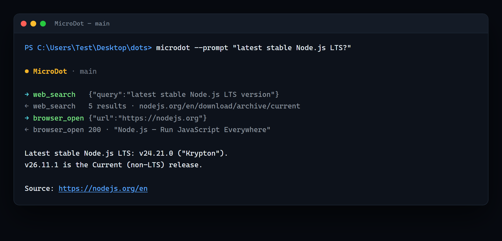

<p align="center">
  <picture>
    <source media="(prefers-color-scheme: dark)" srcset="docs/assets/logo-dark.png">
    <source media="(prefers-color-scheme: light)" srcset="docs/assets/logo.png">
    
  </picture>
</p>

<p align="center">
  <a href="LICENSE"></a>
  
  
</p>

> **Status: working, but in progress** — early and moving fast; expect changing config, tools and layout. **Not production-hardened.**

**A Dot on a diet** — a bare-bones, **self-extending** agent built to run on small servers. No CopilotKit, no React, no server, no DB, no Docker.

- **Builds its own tools** — `create_tool` (sandboxed, pattern-gated) + `list_tools` / `delete_tool`.
- **Delegates to itself** — `spawn_subagent` / `spawn_subagents`: recursive, parallel, nested spaces, roll-up, hard caps.
- **One process, one Chromium** — a tab per agent; started on demand and stopped when idle.
- **Plain-file state** — chats, spaces, worker types, skills, tools. No services to run.
- **Library-ready** — `createRuntime()` + `dot.run()` for your own Node projects; the CLI is just a test harness.

Each CLI window is its own agent sharing that one Chromium.



## Quick start
```sh
npm install
npx playwright install chromium        # Linux/VPS: npx playwright install --with-deps chromium
cp .env.example .env                   # Windows: copy .env.example .env
# set OPENROUTER_API_KEY in .env, or rely on an OpenRouterKey env var
```

```sh
microdot.bat                            # Windows: interactive CLI (agent "main")
./microdot.sh                           # Linux/VPS
microdot.bat --prompt "summarise https://example.com"
microdot.bat --prompt-file task.md      # read a multi-line prompt from a file
microdot.bat --resume <id>              # resume a saved chat
```

## Commands
| command | effect |
|---|---|
| `/new [name] [type]` | open a new worker (own CLI + space + type) |
| `/project [name]` | show/load a project (resumes it); `new <name>`, `delete <name>`, `off` |
| `/resume [id]` | list saved chats, or resume one |
| `/name [title]` | show or set this chat's title |
| `/tools`, `/delete <n>` | list / delete custom tools |
| `/skills` | list saved skills |
| `/type [name]` | show or set this worker's type |
| `/mission [text]` | show or set this space's `mission.md` |
| `/reset`, `/shots`, `/help`, `/exit` | |

Keyboard: paste multi-line text directly (Enter runs it); **Esc** stops a running turn; **Ctrl-C** exits.

## Use as a library
```js
import { createRuntime } from 'microdot';

const rt = await createRuntime({
  apiKey: process.env.OPENROUTER_API_KEY,
  dataDir: '/srv/dots',        // project layer (chats/spaces/tools)
  browser: 'on-demand',        // 'off' (search-only, no Chromium) | 'on-demand' | 'always'
  compact: true,               // keep long runs bounded
});

rt.registerTool({ name: 'app_time', description: 'Current time.', parameters: { type: 'object', properties: {} }, run: async () => ({ now: Date.now() }) });

const dot = await rt.dot('analyst', { type: 'researcher', mission: 'track NVDA' });
const text = await dot.run('summarise the latest earnings', {
  onToken: (t) => process.stdout.write(t),
  onTool: (kind, name) => {},
});

await rt.close(); // stops the shared Chromium + worker when idle
```
See [`examples/run-dot.mjs`](examples/run-dot.mjs). The CLI is a thin test harness over this same core.

## Acknowledgements

MicroDot was built with a lot of help from **DeepSeek V4.1 Flash** (the default
model it runs on). The core refactor, the docs, and the launch prep in this repo
would have taken considerably longer without it. Thank you.

## Docs
- **[docs/guide.md](docs/guide.md)** — architecture, spaces & layers, tools, sub-agents, the sandbox, compaction, cleanup, and the full config reference.
- **[docs/example-run.md](docs/example-run.md)** — a real, unedited run: search + browser + answer.
- **[docs/plan.md](docs/plan.md)** — the launch/execution plan (status + next steps).
- **[ROADMAP.md](ROADMAP.md)** — where it's going; `good first issue`s are welcome.
- **[CONTRIBUTING.md](CONTRIBUTING.md)** · **[SECURITY.md](SECURITY.md)** — how to help, and what to know before running untrusted inputs.
- **[deploy/DEPLOY.md](deploy/DEPLOY.md)** — small-server deploy: systemd unit + timer, lean Chromium flags, resource caps.
- **[LICENSE](LICENSE)** — MIT.
